# FocusTube
This FocusTube Web Application that is developed to help user to focus on the study/work by controling the YouTube usage.
Read spec./README.md for further specification.

## How to launch the Application.
1. Go to the project folder/directory on terminal
2. Run the command  ``` cd FocusTube.API ``` in the
3. Run the command ``` dotnet run ```
4. It should show
``` 
Using launch settings from ...YOUR_DIRECTORY_ADDRESS/FocusTube.API/Properties/launchSettings.json...
Building...
info: Microsoft.Hosting.Lifetime[14]
      Now listening on: http://localhost:5239
info: Microsoft.Hosting.Lifetime[0]
      Application started. Press Ctrl+C to shut down.
info: Microsoft.Hosting.Lifetime[0]
      Hosting environment: Development
info: Microsoft.Hosting.Lifetime[0]
      Content root path: ...YOUR_DIRECTORY_ADDRESS/FocusTube.API
``` 

5. Open the web browser and open the following link
``` http://localhost:5239```

6. The App is launched and ready to use!!


## How to use the app
### Home
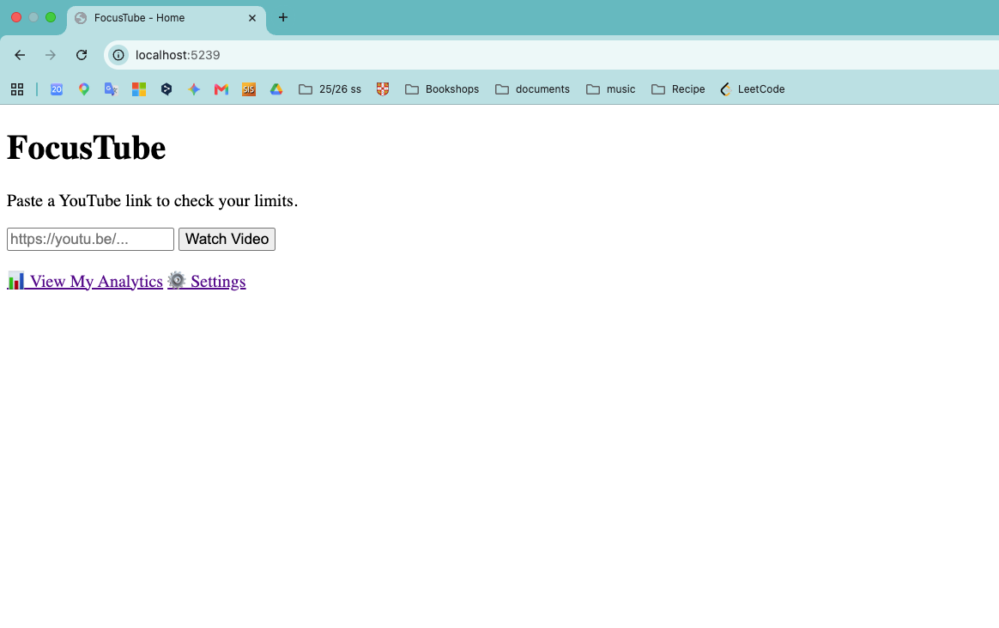
<br>
We have this page as a home.
On this page, we can mainly check if you can watch the video against your limit.
1. Copy the link of the video you want to watch

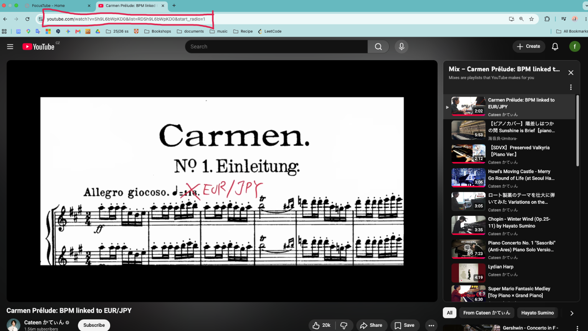
<br>
2. Paste the link to the box in the Home page, and click "Watch Video" button.

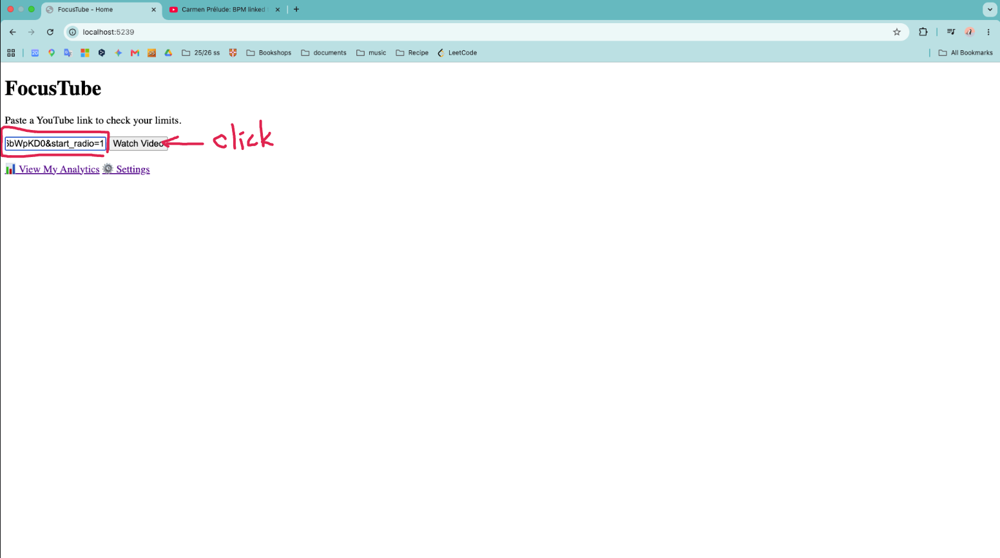
<br>
3. Then it will show the result if you can watch this video or not, regarding to your limit.
<br>
↓If it is allowed

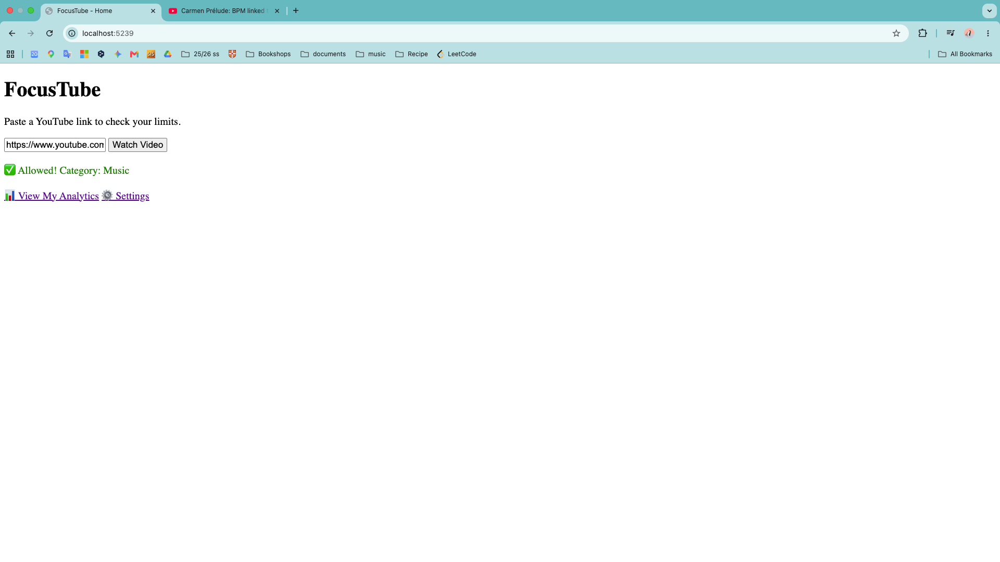
<br>
↓If it is not allowed, you will see this page with the reason of the decline.

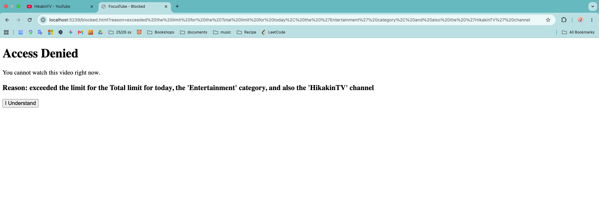


Also, there are two buttons.
- Click the **View My Analytics** button to jump the analytics page<br>
**View My Analytics** page will be explained in the later setction.
- Click the **Settings** button to jump to the setting page<br>
**Settings** page will be explained in the later setction.


### /settings.html
This is the page you see after clicking **Settings** button in the Home.<br>
Here, you can change the limit of **Total Daily Limit**, **By Category**, and **By Channel**.<br>
If you set all the limit, the lowest limit is priotized.
Also, the Education and Science & Technology is excluded from the daily time spent by default, 
and you can't add the limit to these categories as well.

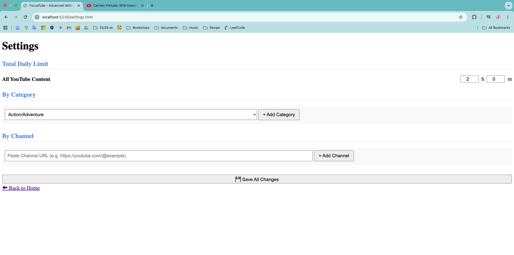

#### Change the limit of Total Daily Limit
By default, the total limit is 2 hours. If you already watched some video before visiting this page, it is showing remained available duration.<br>
To change the Total Daily Limit, simply type the limit you want or click arrow to adjust the value.
After setting the value, click the **Save All Change** at the button, to save the change.
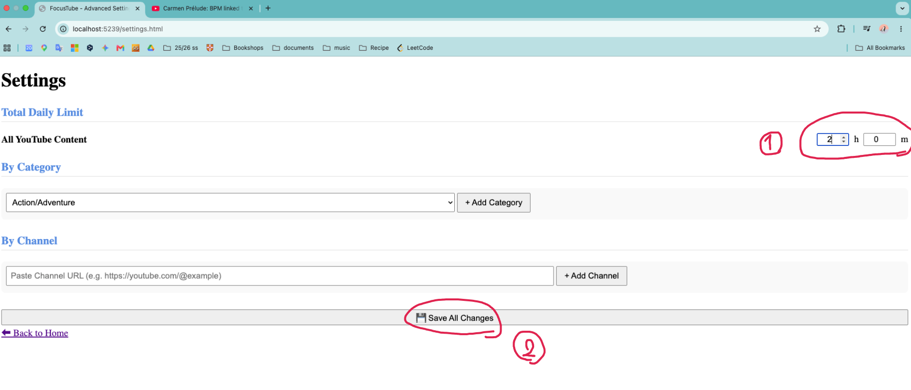


#### Change the limit of By Category
First, the click the pulldown.
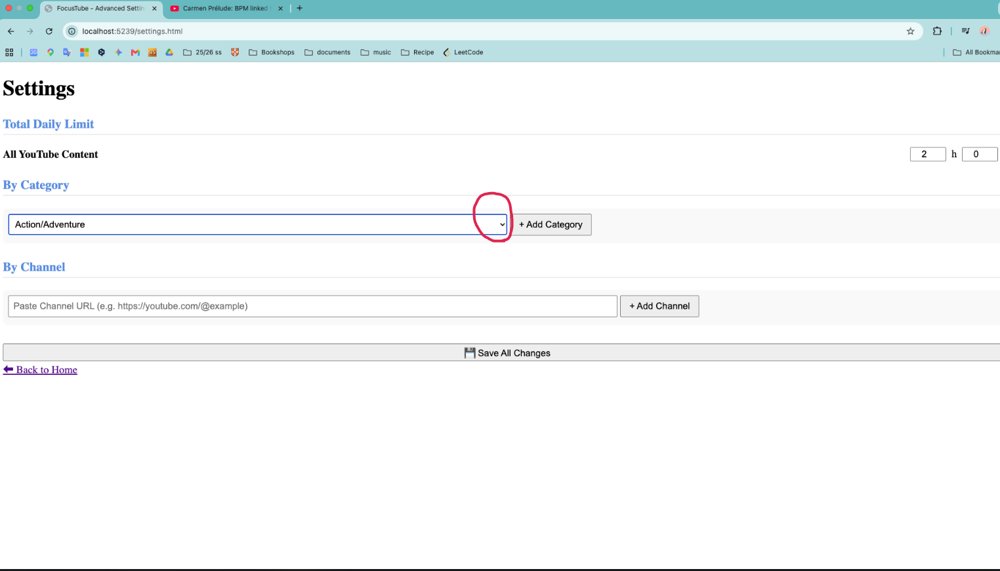

Select the category you want to add the limit.
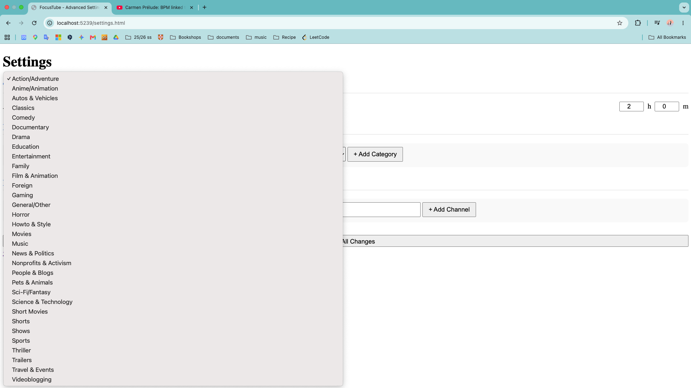

Click **Add Category**
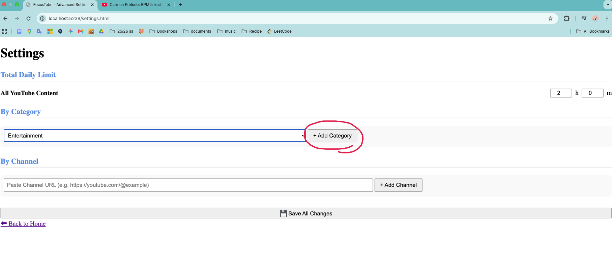

Simply type the limit you want for this category or click arrow to adjust the value.

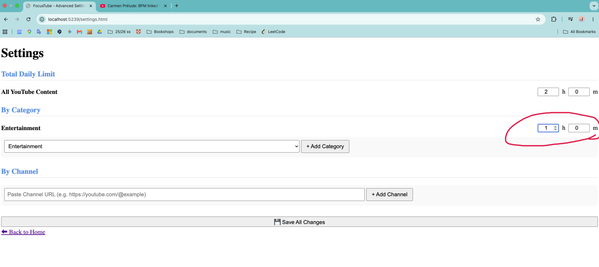

Add as much categories as you want to set the limit.
Once you finish adding them, click **Save All Change**
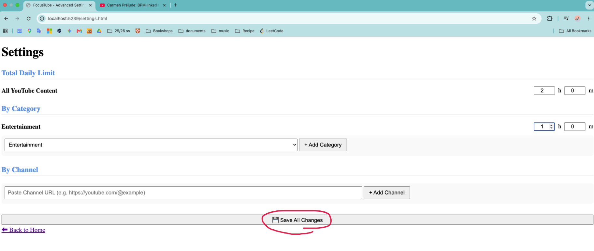

#### Change the limit of By Channel
First, we need to copy the link of the Youtube Channel.
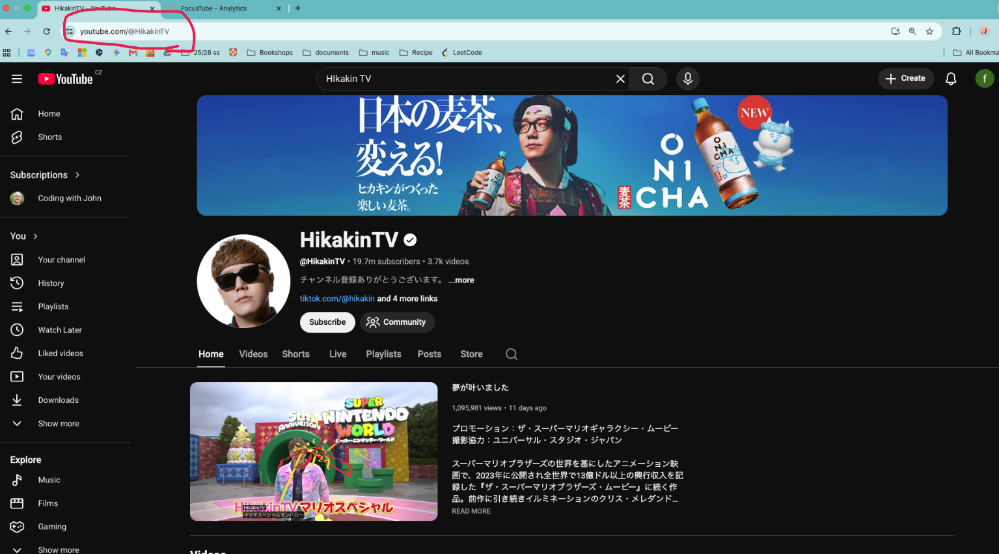

Paste the link to the box and click **Add Channel**
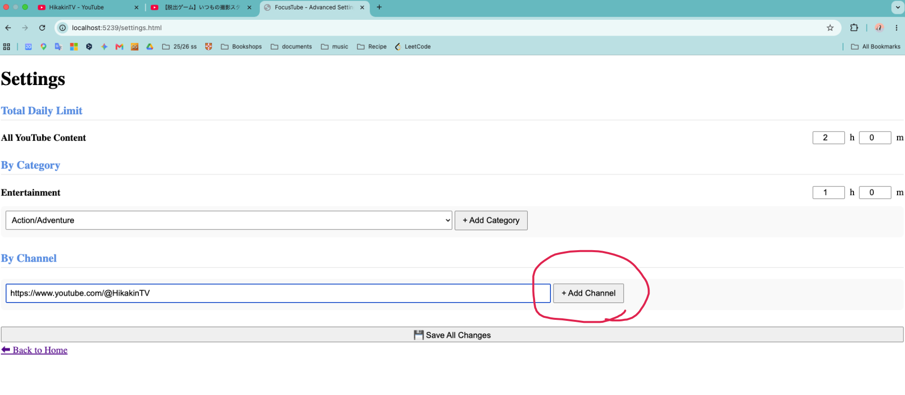

Simply type the limit you want for this channel or click arrow to adjust the value.
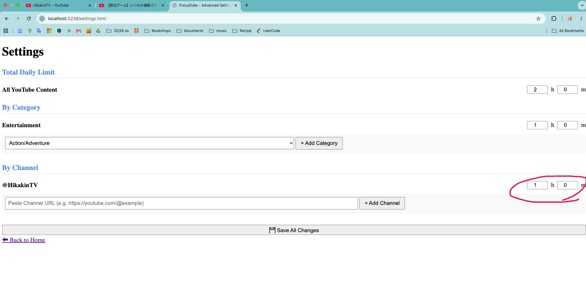

Add as much channels as you want to set the limit.
Once you finish adding them, click **Save All Change**
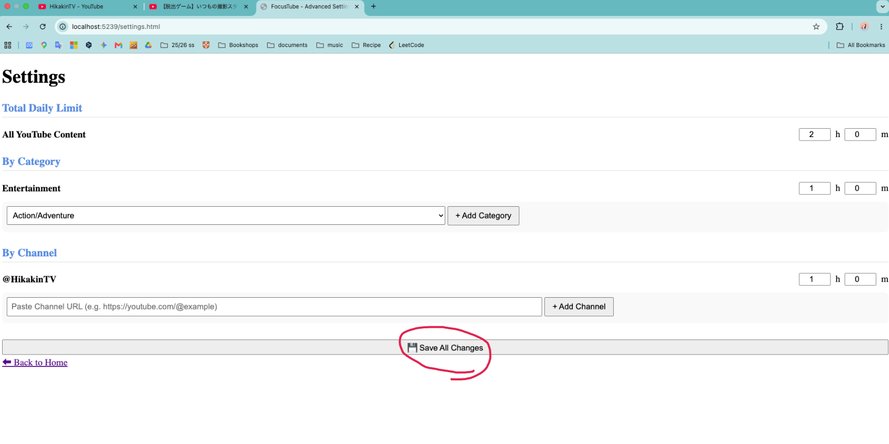


### /analytics.html
This is the page you see after clicking **View My Analytics** button in the Home.
Since we don't include the time spend on Education and Science & Technology category,
the time spend on these field will not reflected here neither at all of
**Total Daily Limit**, **By Category**, and **By Channel**.
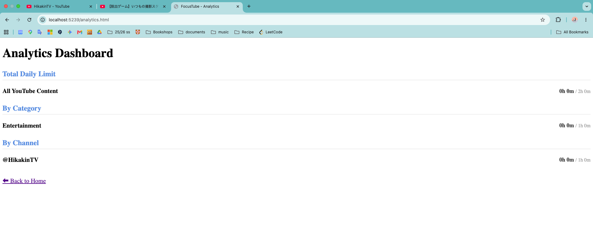

After seeing some video, it will looks like this
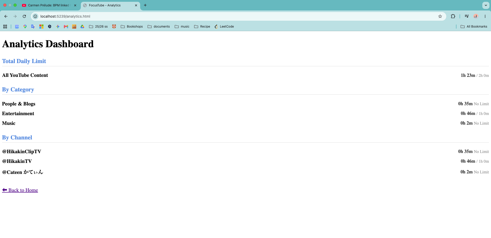